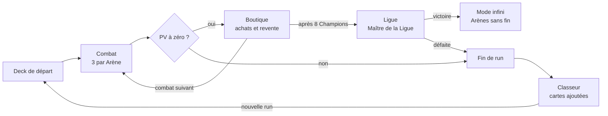
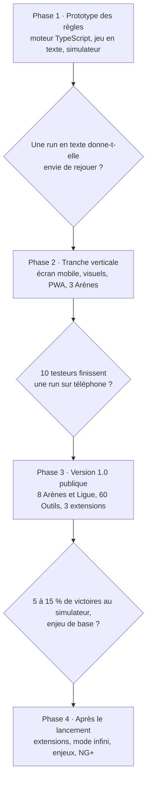

# Combodex — Document de game design

6 novembre 2026 · Alexandre

Ce fichier est la version de référence du document de game design. Les phases de développement sont détaillées dans [`phases/`](phases/).

## Sommaire

- [Vision](#vision)
- [Boucle de jeu](#boucle-de-jeu)
- [Système de scoring](#système-de-scoring)
- [Familles de talents](#familles-de-talents)
- [Ressources de combat](#ressources-de-combat)
- [Amélioration du deck](#amélioration-du-deck)
- [Outils et Stades](#outils-et-stades)
- [Champions d'Arène et difficulté](#champions-darène-et-difficulté)
- [Économie et boutique](#économie-et-boutique)
- [Méta-progression](#méta-progression)
- [Données et technique](#données-et-technique)
- [UX mobile et web](#ux-mobile-et-web)
- [Risques](#risques)
- [Décisions](#décisions)
- [Roadmap](#roadmap)

## Vision

Combodex est un roguelite de deckbuilding gratuit, jouable sur navigateur et mobile. On y enchaîne des combos de cartes Pokémon pour battre 8 Arènes, puis la Ligue.

**Pitch** : « Balatro, mais les mains de poker sont des équipes Pokémon. »

**Inspirations**

- Balatro : scoring Dégâts × Multi, jokers qui s'empilent, boutique entre les combats, mises de difficulté.
- The Binding of Isaac : objets qui modifient les règles et créent des synergies cassées, chaque run est différente.

**Piliers de design**

1. Le combo explosif : un bon tour doit multiplier le score par 10 ou par 100.
2. Réfléchir, pas réagir : tour par tour, sans chronomètre ; chaque main est un petit puzzle.
3. Les vraies cartes comptent : PV, types, faiblesses, retraite, rareté et variantes viennent des données réelles.
4. Des runs reprenables : 30 à 45 minutes, sauvegarde après chaque combat.

**Public** : fans du JCC Pokémon et joueurs de roguelikes de deckbuilding.

**Plateformes** : navigateur desktop et mobile, installable en PWA. Gratuit, sans publicité ni achat, en français et en anglais dès le lancement.

## Boucle de jeu

Une run enchaîne 8 Arènes de 3 combats, puis le Maître de la Ligue ; une seule défaite y met fin.



Chaque Arène oppose un Dresseur, un Dresseur d'élite puis le Champion, avec une boutique après chaque victoire. La Ligue vaincue, le joueur peut continuer en mode infini.

**Une extension par run** : le deck de départ, les boosters et les Champions viennent tous de la même extension. Après une première victoire, les modes New Game+ mélangent plusieurs extensions (voir [Méta-progression](#méta-progression)).

**Déroulé d'un combat**

1. Le joueur pioche jusqu'à avoir 8 cartes en main.
2. Il sélectionne 1 à 5 cartes, puis choisit Jouer ou Défausser.
3. Jouer : la combinaison est calculée et son score retiré des PV du boss ; cela consomme un Tour.
4. Défausser : chaque carte coûte sa valeur de retraite en points de Retraite.
5. PV du boss à zéro : victoire, gains et boutique. Tours épuisés : fin de run.

**Passer un combat** : le Dresseur et le Dresseur d'élite peuvent être passés contre un booster gratuit, mais sans gains ni boutique. Le Champion ne se passe pas.

## Système de scoring

Chaque main jouée inflige (Dégâts de la combinaison + dégâts des cartes) × Multi, retirés des PV du boss. Les valeurs ci-dessous sont un point de départ à équilibrer.

```latex
\text{Score} = \Big(D_{\text{combo}} + \sum D_{\text{cartes}}\Big) \times \Big(M_{\text{combo}} + \sum M_{+}\Big) \times \prod M_{\times}
```

**Ordre de résolution**

1. Le jeu détecte la meilleure combinaison parmi les cartes posées.
2. Les cartes qui forment la combinaison marquent, de gauche à droite : dégâts, variante, énergies attachées.
3. Les Outils se déclenchent de gauche à droite : tous les +Multi, puis les ×Multi dans l'ordre des emplacements.
4. La faiblesse du boss double le Multi si une carte jouée a ce type. Sa résistance retire 30 Dégâts par carte du type résisté.

**Dégâts d'une carte** : ceux de sa meilleure attaque. Un suffixe comme « 30+ » ou « 50× » est ignoré. Une carte sans attaque chiffrée vaut 20.

**Cartes TAG TEAM** : une carte TAG TEAM compte comme chacun des Pokémon qu'elle réunit (2 ou 3, d'après son champ `dexId`). Les combinaisons comptent donc des Pokémon, pas des cartes : 5 cartes posées peuvent représenter plus de 5 Pokémon. Ses dégâts ne comptent qu'une fois.

**Talents** : une vingtaine de familles d'effets (pioche, bonus de Multi sous condition, soin du deck…) sont écrites à la main. Le script de build rattache chaque talent à une famille grâce aux mots-clés de son texte, puis une liste de corrections manuelles règle les cas ambigus. Voir [Familles de talents](#familles-de-talents).

**Les combinaisons**

| Combinaison | Condition | Dégâts | Multi |
| --- | --- | --- | --- |
| Carte seule | aucune autre combinaison | 10 | 1 |
| Paire | 2 fois le même Pokémon (même `dexId`) | 20 | 2 |
| Brelan | 3 fois le même Pokémon | 50 | 3 |
| Arc-en-ciel | 5 types différents | 60 | 4 |
| Monotype | 5 Pokémon du même type | 70 | 4 |
| Lignée | Base + Niveau 1 + Niveau 2 d'une même évolution | 80 | 4 |
| Famille | Brelan + Paire | 80 | 4 |
| Carré | 4 fois le même Pokémon | 120 | 7 |
| Lignée monotype | Lignée + 5 Pokémon du même type | 200 | 8 |
| Quinte | 5 fois le même Pokémon | 300 | 12 |

**Exemple chiffré** : Lignée monotype Feu contre un Champion Plante, faible au Feu.

- Dégâts : 200 de base + 30 + 60 + 150 + 40 + 50 pour les cartes = 530
- Multi : 8 de base + 10 (Niveau 2 holo) + 20 (Feu de camp, 5 cartes Feu) = 38, puis ×2 pour la faiblesse = 76
- Score : 530 × 76 = **40 280**

## Familles de talents

20 familles couvrent les talents de toutes les extensions. Les valeurs restent à équilibrer.

- Sauf mention « en main », un talent se déclenche quand la carte est posée et marque.
- Le script teste les familles dans l'ordre de priorité et garde la première dont un mot-clé apparaît dans le texte du talent. La recherche ignore les majuscules et les accents.
- La liste de corrections manuelles l'emporte toujours sur les mots-clés.
- Les mots-clés ont été vérifiés sur 7 extensions et sont à revalider à chaque nouvelle extension.

| Priorité | Famille (FR / EN) | Effet dans Combodex | Mots-clés FR | Mots-clés EN |
| --- | --- | --- | --- | --- |
| 1 | Copie / Copy | marque les Dégâts de la carte la plus forte de la main | utiliser les attaques, utiliser l'attaque | use the attacks, use the attack, use any attack |
| 2 | Polyvalence / Versatile | compte comme tous les types pour les combinaisons | tous les types | every type, all types |
| 3 | Évolution / Evolution | une Base de sa lignée dans le deck évolue gratuitement, une fois par Arène | évolu | evolve |
| 4 | Récupération / Recovery | une carte défaussée pendant ce combat revient en main | pile de défausse + dans votre main (les deux) | discard pile + into your hand (both) |
| 5 | Marqueurs / Counters | inflige 2 % des PV max du Champion, hors calcul (ni Multi ni faiblesse) | marqueurs de dégâts | damage counters |
| 6 | Affliction / Affliction | le Champion perd 3 % de ses PV max à chaque fin de Tour jusqu'à la fin du combat, non cumulable | empoisonné, brûlé, endormi, paralysé, confus | poisoned, burned, asleep, paralyzed, confused |
| 7 | Protection / Shield | la carte ignore la résistance du Champion et les statuts | évitez, prévenez, ne peut pas être affecté | prevent, can't be affected |
| 8 | Soin / Heal | annule le prochain statut annoncé | soign | heal |
| 9 | Énergie / Energy | une carte au hasard du deck reçoit une énergie de son type, de façon permanente | attach, carte Énergie | attach, Energy card |
| 10 | Recherche / Search | au prochain Tour, le joueur choisit 1 carte parmi les 3 du dessus du deck | cherch | search |
| 11 | Vision / Scout | en main : les 3 prochaines cartes du deck sont visibles | regardez, dessus de votre deck | look at, top of your deck |
| 12 | Pioche / Draw | pioche 1 carte de plus au prochain Tour | pioch | draw |
| 13 | Échange / Switch | en main : une fois par combat, s'échange gratuitement contre la carte du dessus du deck | échang | switch |
| 14 | Agilité / Agility | en main : coût de retraite −1 pour toutes les cartes de la main | coût de retraite | retreat cost |
| 15 | Puissance / Power | +20 Dégâts aux autres cartes posées du même type | dégâts supplémentaires, dégâts de plus | more damage |
| 16 | Récompense / Reward | +2 ₽ si la main bat le Champion | récompense | prize |
| 17 | Défausse / Discard | +1 point de Retraite pour le reste du combat | défauss | discard |
| 18 | Banc / Bench | +1 Multi par carte restée en main | banc | bench |
| 19 | Pile ou face / Coin Flip | pile ou face : sur face, ×2 Multi pour cette main | lancez une pièce, pile ou face | flip a coin |
| 20 | Générique / Generic | +2 Multi | aucun mot-clé reconnu | no keyword matched |

Les familles très fréquentes dans les textes (Banc, Défausse, Pile ou face) passent en dernier, pour ne pas capter des talents qui relèvent d'une famille plus précise.

**Test sur Éclipse Cosmique** : 83 % des 64 talents sont reconnus, et 98 % tombent dans la même famille en français et en anglais. Les autres reçoivent l'effet Générique ou passent par la liste de corrections.

**Glossaire français → anglais**

| Français | Anglais |
| --- | --- |
| Dégâts | Damage |
| Multi | Mult |
| Tour | Turn |
| Combat | Fight |
| Point de Retraite | Retreat point |
| Outil | Tool |
| Arène | Arena |
| Champion | Champion |
| Lignée | Evolution line |
| Pokédollar (₽) | Pokédollar (₽) |

**Effets en anglais**

| Family | Effect in Combodex |
| --- | --- |
| Copy | scores the Damage of the strongest card in hand |
| Versatile | counts as every type for combinations |
| Evolution | a Basic of its line in the deck evolves for free, once per Arena |
| Recovery | a card discarded during this fight returns to hand |
| Counters | deals 2% of the Champion's max HP outside the calculation (no Mult, no weakness) |
| Affliction | the Champion loses 3% of its max HP at the end of each Turn until the fight ends; does not stack |
| Shield | the card ignores the Champion's resistance and statuses |
| Heal | cancels the next announced status |
| Energy | a random card in the deck permanently gains an Energy of its type |
| Search | next Turn, the player picks 1 card among the top 3 of the deck |
| Scout | in hand: the next 3 cards of the deck are visible |
| Draw | draw 1 extra card next Turn |
| Switch | in hand: once per fight, swaps for free with the top card of the deck |
| Agility | in hand: Retreat cost −1 for every card in hand |
| Power | +20 Damage to the other played cards of the same type |
| Reward | +2 ₽ if the hand defeats the Champion |
| Discard | +1 Retreat point for the rest of the fight |
| Bench | +1 Mult per card left in hand |
| Coin Flip | flip a coin: on heads, ×2 Mult for this hand |
| Generic | +2 Mult |

## Ressources de combat

Un combat se joue avec une main de 8 cartes, 4 Tours et 4 points de Retraite. On pose de 1 à 5 cartes par Tour.

| Ressource | Départ | Rôle | Équivalent Balatro |
| --- | --- | --- | --- |
| Main | 8 cartes | piochées dans le deck mélangé, complétée après chaque action | main |
| Cartes posées | 1 à 5 par Tour, 6 avec l'Outil Grand banc | forment la combinaison | cartes jouées |
| Tours | 4 par combat | nombre de mains jouables | mains |
| Retraites | 4 points par combat | défausser une carte coûte sa valeur de retraite (0 à 4) | défausses |
| Deck | 20 cartes au départ | grandit et s'affine entre les combats | deck |

**Pourquoi la retraite comme coût de défausse** : les gros frappeurs ont souvent une retraite de 3 ou 4. Ils encombrent la main s'ils ne servent pas. Les petits Pokémon à retraite 0 deviennent précieux pour faire tourner la main.

**Deck de départ (20 cartes, une extension)**

- 2 lignées complètes de types différents : 2 Base, 2 Niveau 1 et 1 Niveau 2 chacune, soit 10 cartes.
- 10 Pokémon de Base variés, sur 2 ou 3 types, dont quelques doublons pour permettre les Paires.
- Le générateur choisit les lignées dans l'extension du deck de départ (`stage` et `evolveFrom`).

Seules les cartes Pokémon entrent dans le deck : les cartes Dresseur réelles ne sont pas utilisées.

## Amélioration du deck

Le deck progresse de quatre façons entre les combats : évolution, énergies, variantes et cartes ACE SPEC.

**Évolution permanente** (équivalent des tarots de Balatro)

- Un Niveau 1 acheté se pose sur une Base de la même lignée dans le deck.
- La carte devient le Niveau 1 et garde ses énergies et sa variante.
- Un objet rare permet de passer directement de la Base au Niveau 2.

**Énergies attachées** (consommables)

- Une énergie de base ajoute son type à la carte, qui devient double type, et +10 Dégâts.
- Cela facilite les Monotype et les Arc-en-ciel.
- Une énergie spéciale a un effet unique, écrit à la main.

**Variantes** (équivalent des éditions de Balatro)

| Variante | Effet | Rareté en boutique |
| --- | --- | --- |
| Normale | aucun | courante |
| Reverse | +30 Dégâts | peu courante |
| Holo | +10 Multi | rare |
| 1re édition | ×1,5 Multi | très rare |

Une carte n'apparaît que dans une variante qui existe pour elle, d'après le champ `variants` de TCGdex.

**ACE SPEC** (équivalent des cartes spectrales)

- Consommables surpuissants, un seul en réserve à la fois.
- Exemples : toutes les cartes de la main deviennent holo ; duplique une carte du deck avec ses bonus ; détruit 3 cartes du deck et ajoute un emplacement d'Outil.

**Centre Pokémon** : une fois par Arène, retire gratuitement une carte du deck. Un deck plus fin pioche plus souvent ses combos.

## Outils et Stades

Les Outils et Stades sont les jokers du jeu : 5 emplacements d'effets passifs qui s'appliquent à chaque main, dans l'ordre choisi par le joueur.

**Règles**

- 5 emplacements au départ, réordonnables entre deux Tours.
- Un Outil est un effet passif permanent.
- Un Stade est un effet global plus fort, un seul actif à la fois : un nouveau Stade remplace l'ancien.
- Achetés en boutique, revendus pour la moitié de leur prix.
- Visuels originaux, pas les cartes Dresseur réelles : leur texte imprimé contredirait l'effet en jeu.

**Catalogue initial**

| Outil | Archétype | Effet | Rareté |
| --- | --- | --- | --- |
| Feu de camp (une version par type, 11 au total) | Monotype | +4 Multi par carte de ce type jouée | Commune |
| Pique-nique | Économie | +2 ₽ par Tour non utilisé en fin de combat | Commune |
| Sac léger | Défausse | défausser une carte à retraite 0 rapporte 1 ₽ | Commune |
| Colosse | Tank | une carte compte ses PV au lieu de ses dégâts | Peu commune |
| Contre-type | Faiblesse | la faiblesse du boss donne ×3 au lieu de ×2 | Peu commune |
| Prisme | Arc-en-ciel | les cartes Incolore comptent comme n'importe quel type | Peu commune |
| Arbre généalogique | Lignée | une carte rejoue ses dégâts si sa pré-évolution est aussi jouée | Rare |
| Classeur rigide | Collection | ×1,5 Multi par carte holo jouée | Rare |
| Pokédex | Montée en puissance | +1 Multi par Pokémon différent joué pendant la run | Rare |
| Entraînement | Montée en puissance | gagne ×0,1 Multi permanent à chaque Lignée jouée | Rare |
| Illustrateur fétiche | Atelier | ×2 Multi si toutes les cartes jouées ont le même illustrateur | Rare |
| Grand banc | Combinaison | permet de poser 6 cartes ; la 6e marque si elle entre dans la combinaison | Rare |
| La Cote | Collection | +Multi égal au prix Cardmarket de la carte en euros, plafonné à 50 | Légendaire |

**Synergies cassées recherchées**

- Prisme + Feu de camp : les Incolore remplissent n'importe quel Monotype.
- Classeur rigide + l'ACE SPEC « tout en holo » : un tour à plusieurs centaines de milliers.
- Colosse + Contre-type dans un deck de gros PV : l'archétype tank qui inverse la valeur des cartes.
- Arbre généalogique + Entraînement : un deck Lignée qui grandit à chaque combat.

Une run sur dix peut « casser » le jeu. C'est le plaisir recherché, comme dans Isaac ; l'équilibrage vise les runs moyennes, pas les exceptions.

## Champions d'Arène et difficulté

Les PV du Champion passent de 600 à 100 000 sur les 8 Arènes, puis 150 000 pour le Maître de la Ligue. La courbe s'inspire de celle de Balatro.

| Étape | PV du Champion (valeurs provisoires) |
| --- | --- |
| Arène 1 | 600 |
| Arène 2 | 1 600 |
| Arène 3 | 4 000 |
| Arène 4 | 10 000 |
| Arène 5 | 22 000 |
| Arène 6 | 40 000 |
| Arène 7 | 70 000 |
| Arène 8 | 100 000 |
| Ligue | 150 000 |

Le Dresseur a la moitié des PV du Champion, le Dresseur d'élite les trois quarts. En mode infini, les PV augmentent de 60 % par Arène. La main de l'exemple chiffré (40 280) suffit à battre seule le Champion de l'Arène 6 : c'est le niveau de puissance visé en milieu de run.

**Le Champion** est une vraie carte Pokémon à gros PV, du type de l'Arène. Sa vraie faiblesse et sa vraie résistance s'appliquent. Chaque run tire ses Arènes parmi les types présents dans l'extension, dans un ordre aléatoire. S'il y en a moins de 8, des types reviennent pour compléter, avec l'autre forme d'effet (permanent ou statuts) que lors de leur première apparition.

**Effets de boss** : chaque Champion a soit un effet permanent, actif pendant tout le combat, soit un ou plusieurs statuts tirés au hasard à chaque Tour. Les effets dépendent du type de l'Arène, avec plusieurs variantes par type pour éviter la répétition. Certains statuts passent par un pile ou face ou un dé, comme dans le JCC, et peuvent donc échouer.

**Statuts par Tour**

- Au début de chaque Arène, le Champion tire soit son effet permanent, soit ses statuts par Tour, avec une chance sur deux.
- Un seul statut par Tour, tiré parmi les trois statuts du type de l'Arène.
- Le statut du Tour suivant est annoncé pendant le Tour en cours ; celui du premier Tour est annoncé au début du combat.
- Le jet a lieu au début du Tour concerné. En cas d'échec, le statut ne s'applique pas.
- Les chances ne changent pas au fil de la run. Les statuts passent en version renforcée à partir de l'Arène 5 et pour la Ligue.
- Le Maître de la Ligue tire chaque Tour un statut renforcé parmi tous les types.

Chances : pile ou face et dé 1 à 3 = 50 % ; dé 1 à 4 = 67 % ; aucun jet = toujours appliqué.

| Type | Statut | Jet | Effet de base (Arènes 1 à 4) | Version renforcée (Arène 5 et plus) |
| --- | --- | --- | --- | --- |
| Plante | Photosynthèse | pile ou face | le Champion récupère 5 % de ses PV max | 10 % |
| Plante | Racines | aucun | coût de retraite +1 pour toutes les cartes de la main | +2 |
| Plante | Lianes | dé 1 à 3 | main réduite à 7 cartes | 6 cartes |
| Feu | Brûlure | pile ou face | une carte au hasard de la main est défaussée sans coût | elle quitte aussi le deck jusqu'à la fin de l'Arène |
| Feu | Fournaise | aucun | −10 Dégâts par carte posée | −20 Dégâts par carte |
| Feu | Cendres | dé 1 à 4 | les énergies attachées ne donnent pas leurs +10 Dégâts | ni leur type ajouté |
| Eau | Marée | pile ou face | 2 cartes au hasard de la main retournent dans le deck et sont remplacées | 4 cartes |
| Eau | Courant | aucun | −1 point de Retraite pour le reste du combat | −2 points |
| Eau | Brume | dé 1 à 3 | le nom de la combinaison et le score estimé sont masqués avant de jouer | les dégâts des cartes aussi |
| Électrique | Paralysie | pile ou face | une carte au hasard de la main ne peut pas être jouée | 2 cartes |
| Électrique | Surtension | dé 1 à 3 | les ×Multi se déclenchent avant les +Multi | les Outils se déclenchent dans un ordre aléatoire |
| Électrique | Statique | pile ou face | les cartes à retraite 0 ne marquent pas leurs Dégâts | ni leur bonus de variante |
| Psy | Confusion | pile ou face | l'ordre des cartes posées est mélangé avant le calcul | et une carte posée au hasard ne marque rien |
| Psy | Hypnose | aucun | 2 cartes de la main sont face cachée | 4 cartes |
| Psy | Prémonition | aucun | la combinaison la plus jouée de la run donne −2 Multi | −4 Multi |
| Combat | Intimidation | pile ou face | −2 Multi à la prochaine main | −4 Multi |
| Combat | Garde haute | dé 1 à 4 | seules les 4 premières cartes posées marquent | les 3 premières |
| Combat | Contre-attaque | pile ou face | sans carte du type faible du Champion, la main perd 20 % de ses Dégâts | 40 % |
| Obscurité | Poison | aucun | la main perd 10 % de ses Dégâts, cumulable d'un Tour à l'autre | 20 % par Tour |
| Obscurité | Vol | pile ou face | le joueur perd 2 ₽ | 4 ₽ |
| Obscurité | Embuscade | dé 1 à 3 | un Outil au hasard ne se déclenche pas | 2 Outils |
| Métal | Armure | aucun | le Champion absorbe l'équivalent de 5 % de ses PV max à la prochaine main | 10 % |
| Métal | Blindage | pile ou face | la résistance du Champion double | triple |
| Métal | Lourdeur | dé 1 à 4 | les cartes à retraite 3 ou plus ne marquent que la moitié de leurs Dégâts | le quart |
| Fée | Charme | pile ou face | les Outils Collection ne se déclenchent pas | et les variantes n'ont aucun effet |
| Fée | Attraction | aucun | une carte au hasard de la main doit être jouée ce Tour | 2 cartes |
| Fée | Voile | dé 1 à 3 | la première carte posée ne marque rien | les 2 premières |
| Dragon | Écailles | pile ou face | la faiblesse du Champion ne s'applique pas | et les Outils Faiblesse non plus |
| Dragon | Fureur | dé 1 à 3 | la résistance du Champion s'applique à tous les types | et vaut −50 Dégâts par carte |
| Dragon | Colère | pile ou face | la combinaison jouée descend d'un rang (ex. Carré compté comme Brelan) | de deux rangs |
| Incolore | Copie | aucun | un statut d'un autre type, tiré au hasard, s'applique dans sa version de base | dans sa version renforcée |
| Incolore | Plaquage | pile ou face | la main perd 15 % de ses Dégâts | 30 % |
| Incolore | Hurlement | dé 1 à 3 | une carte posée au hasard ne marque rien | 2 cartes |

**Effets permanents**, un par type d'Arène :

| Arène | Effet permanent |
| --- | --- |
| Eau | les cartes Feu ne marquent rien |
| Électrique | le combat ne dure que 3 Tours au lieu de 4 |
| Psy | les cartes sont piochées face cachée |
| Plante | le Champion récupère 10 % de ses PV à chaque Tour |
| Combat | seules les 3 premières cartes posées marquent |
| Obscurité | un Outil au hasard est désactivé pendant le combat |
| Métal | −50 % sur la combinaison la plus jouée de la run |
| Feu | les cartes défaussées quittent le deck jusqu'à la fin de l'Arène |
| Fée | les variantes (reverse, holo, 1re édition) n'ont aucun effet |
| Dragon | la faiblesse ne s'applique pas |
| Incolore | les Outils liés à un type (Feu de camp, Prisme) ne se déclenchent pas |
| Maître de la Ligue | change de faiblesse à chaque Tour et applique l'effet d'une Arène au hasard |

## Économie et boutique

Chaque victoire rapporte des Pokédollars (₽), dépensés dans une boutique qui s'ouvre après chaque combat.

**Gains**

- Victoire : 3 ₽ contre un Dresseur, 4 ₽ contre un Dresseur d'élite, 5 ₽ contre un Champion.
- +1 ₽ par Tour non utilisé.
- Intérêts : +1 ₽ par tranche de 5 ₽ détenus, plafonnés à 5 ₽ par combat.

**Contenu de la boutique** : 2 emplacements de cartes ou d'Outils, 2 boosters et 1 consommable. Relancer coûte 5 ₽, puis 1 ₽ de plus à chaque relance.

| Booster | Prix | Contenu | Cartes gardées |
| --- | --- | --- | --- |
| Booster d'extension | 4 ₽ | 5 Pokémon d'une vraie extension, tirés selon leur rareté | 1 |
| Booster Énergie | 4 ₽ | 3 énergies | 1 |
| Booster Dresseur | 6 ₽ | 3 Outils ou Stades | 1 |
| Booster Premium | 8 ₽ | 5 Pokémon dont 1 holo garanti | 2 |

Le booster d'extension reprend le visuel du vrai booster quand TCGdex le fournit (champ `boosters`). Son ouverture est le moment fort de la boutique : animation, révélation carte par carte.

**Prix à l'unité** : 2 ₽ pour une Commune, 3 ₽ pour une Peu commune, 5 ₽ pour une Rare, 8 ₽ pour une Ultra rare. Le prix Cardmarket ne sert qu'à l'Outil La Cote, car il manque pour une partie des cartes.

**Cartes TAG TEAM** : elles ne sont jamais vendues à l'unité et sortent uniquement des boosters, au taux d'une Ultra rare (environ 1 booster sur 10). Un deck en contient au plus 2.

## Méta-progression

Entre les runs, le joueur garde un Classeur : chaque carte vue s'y ajoute et débloque de la variété, jamais de la puissance brute.

- **Classeur** : toutes les cartes vues ou gagnées, classées par extension, avec un taux de complétion.
- **Decks de départ** : compléter 25 % d'une extension débloque son deck de départ.
- **Outils à débloquer** : certains n'apparaissent en boutique qu'après un exploit, par exemple gagner une run avec un deck monotype.
- **Enjeux de difficulté** : battre la Ligue débloque l'enjeu suivant, 8 niveaux comme les mises de Balatro.
- **New Game+** : une fois la Ligue battue, de nouvelles runs mélangent 2 extensions (NG+), puis 3 (NG++), et ainsi de suite. Le NG+ et l'enjeu de difficulté sont deux axes séparés : chacun se débloque à part, et le joueur combine les deux avant la run.
- **Défi du jour** : même graine pour tous, une extension imposée, classement par meilleur score en une main.
- **Graines partageables** : une run se rejoue à l'identique avec un code court.

## Données et technique

Les données viennent de TCGdex, figées au build dans un JSON léger ; seules les images sont chargées pendant le jeu.

| Champ TCGdex | Usage en jeu |
| --- | --- |
| `dexId` | Paire, Brelan, Carré, Quinte ; plusieurs valeurs pour une carte TAG TEAM |
| `types` | Monotype, Arc-en-ciel, faiblesse du boss |
| `stage`, `evolveFrom` | Lignée, évolution permanente, deck de départ |
| `attacks[].damage` | dégâts de la carte |
| `hp` | PV des Champions, Outil Colosse |
| `weaknesses`, `resistances` | multiplicateurs contre le Champion |
| `retreat` | coût de défausse |
| `rarity` | prix en boutique, tirages en booster |
| `variants` | variantes possibles pour la carte |
| `illustrator` | Outil Illustrateur fétiche |
| `set`, `boosters` | boosters et decks de départ |
| `pricing.cardmarket` | Outil La Cote |
| `image` | visuel : `low.webp` en jeu, `high.webp` au zoom |
| `abilities` | texte du talent, classé dans une famille par mots-clés |

**Pipeline de données**

1. Un script Node lit les données TCGdex au moment du build : dépôt open source [`tcgdex/cards-database`](https://github.com/tcgdex/cards-database) (épinglé sur un commit) ou API REST.
2. Il garde les cartes Pokémon qui ont une image et au moins une attaque.
3. Il normalise les dégâts (« 30+ » devient 30) et applique une liste d'exclusion manuelle.
4. Il exporte un fichier de cartes par extension jouable, avec les textes en français et en anglais.
5. On relance le script à la sortie d'une nouvelle extension. Le jeu n'appelle jamais l'API.

Les détails techniques (lecture du dépôt sans exécuter ses fichiers, index des images) sont dans [la phase 1](phases/phase-1-prototype.md#données-tcgdex).

**Stack proposée**

- Moteur de règles en TypeScript pur, sans interface : testable, déterministe grâce à une graine aléatoire.
- Interface en Svelte ou React, cartes rendues en DOM et CSS ; effet holo en CSS.
- PWA : service worker pour le hors-ligne et le cache des images déjà vues.
- Sauvegarde locale en IndexedDB.
- Hébergement statique gratuit : GitHub Pages, Cloudflare Pages ou Netlify.

**Traductions** : tous les textes écrits à la main (interface, Outils, talents réécrits, statuts) vivent dans des fichiers fr et en dès le prototype, jamais en dur dans le code.

Références : [objet Card](https://tcgdex.dev/fr/reference/card), [FAQ TCGdex](https://tcgdex.dev/fr/faq).

## UX mobile et web

L'écran de combat tient en portrait sur un téléphone de 360 px de large, sans défilement vertical.

**Disposition en portrait, de haut en bas**

1. Champion : sa carte, ses PV restants, sa faiblesse, sa résistance et son effet de boss.
2. Compteur : Dégâts × Multi en gros chiffres animés.
3. Outils : 5 emplacements en ligne ; appui long pour lire l'effet.
4. Zone de jeu : les cartes posées ce Tour.
5. Main : 8 cartes en éventail, défilables horizontalement.
6. Boutons : Jouer, Défausser, Trier par type ou par lignée.

**Gestes** : toucher pour sélectionner, glisser pour réordonner les cartes ou les Outils, appui long pour zoomer en haute définition.

**Lisibilité du scoring**

- Avant de jouer, le nom de la combinaison détectée et son score estimé s'affichent.
- Pendant le calcul, chaque carte puis chaque Outil s'allume à son tour avec son bonus (+60, +4 Multi, ×2).
- Vitesse d'animation réglable, et un bouton pour passer.

**Desktop** : même écran en paysage, raccourcis clavier (1 à 8 pour sélectionner, Entrée pour jouer, D pour défausser).

**Accessibilité** : chaque type a une icône en plus de sa couleur ; jamais la couleur seule.

## Risques

Le risque principal est juridique : les visuels des cartes appartiennent à The Pokémon Company, qui a déjà fait fermer des fan games, comme Pokémon Uranium et Pokémon Prism en 2016.

| Risque | Probabilité | Impact | Parade |
| --- | --- | --- | --- |
| Mise en demeure de The Pokémon Company | moyenne, plus forte si le jeu devient populaire | fermeture du jeu | 100 % gratuit, sans pub ni dons ; cartes conçues comme un « skin » remplaçable ; Outils en visuels originaux |
| Équilibrage cassé | élevée | runs trop faciles ou impossibles | simulateur de runs en ligne de commande dès le prototype |
| Prix Cardmarket absents | élevée | Outil La Cote peu fiable | plafond à 50, repli sur la rareté |
| Données incomplètes ou fausses | moyenne | cartes injouables | filtrage au build, liste d'exclusion manuelle |
| Images lourdes sur mobile | moyenne | lenteur, consommation de données | `low.webp`, préchargement de la main uniquement |
| Fin du service TCGdex | faible | plus de nouvelles extensions | données figées au build ; images à réhéberger si besoin |

Cette section n'est pas un avis juridique. Le jeu crédite TCGdex et indique qu'il n'est ni affilié ni approuvé par The Pokémon Company.

## Décisions

Toutes les questions ouvertes de la phase de conception sont tranchées.

| Question | Décision |
| --- | --- |
| Nom du jeu | Combodex |
| Cartes d'une run | Une seule extension ; NG+ mélange 2 extensions, NG++ 3, et ainsi de suite |
| Cartes Dresseur | Non utilisées : seuls les Pokémon sont joués |
| Talents | Une vingtaine de familles d'effets ; chaque talent y est rattaché par mots-clés, avec des corrections manuelles |
| Effets du Champion | Effet permanent ou statuts aléatoires par Tour, selon le type de l'Arène ; certains passent par un pile ou face ou un dé et peuvent échouer |
| Points de Retraite | 4 par combat |
| 6e carte | Outil rare Grand banc ; la 6e carte marque si elle entre dans la combinaison |
| Langues | Français et anglais dès le lancement |
| Statuts par Tour | Annoncés un Tour d'avance, tirés au début du Tour, versions renforcées à partir de l'Arène 5 |
| Extension à moins de 8 types | Les types reviennent, avec l'autre forme d'effet que lors de leur première apparition |
| NG+ et enjeux | Deux axes séparés, débloqués à part et combinés avant la run |
| Extension du prototype | Éclipse Cosmique (sm12, 2019) : 11 types, 14 lignées complètes, 64 talents, images complètes en français et en anglais |
| Cartes TAG TEAM | Comptent comme chacun des Pokémon qu'elles réunissent ; obtenues uniquement en booster (environ 1 sur 10), 2 au maximum par deck |

## Roadmap

Le premier jalon est un prototype en texte, sans visuels, pour vérifier que le scoring est amusant avant tout travail d'interface. Chaque phase ne démarre que si la porte précédente est franchie.



| Phase | Document |
| --- | --- |
| 1 · Prototype des règles | [phase-1-prototype.md](phases/phase-1-prototype.md) |
| 2 · Tranche verticale | [phase-2-tranche-verticale.md](phases/phase-2-tranche-verticale.md) |
| 3 · Version 1.0 publique | [phase-3-version-1.md](phases/phase-3-version-1.md) |
| 4 · Après le lancement | [phase-4-apres-lancement.md](phases/phase-4-apres-lancement.md) |

Le simulateur de la phase 1 sert ensuite à chaque rééquilibrage.
